# ExpenseFlow — Architecture & Workflow Documentation

> **Last Updated:** October 2026  
> **Tech Stack:** Spring Boot 3.2.3 (Java 17) · React 18 (Vite 5) · MySQL · JWT · Recharts

---

## Table of Contents

1. [High-Level System Architecture](#1-high-level-system-architecture)
2. [Project Directory Structure](#2-project-directory-structure)
3. [Backend Architecture (Spring Boot)](#3-backend-architecture-spring-boot)
   - [3.1 Layered Architecture](#31-layered-architecture)
   - [3.2 Entity / Database Schema](#32-entity--database-schema)
   - [3.3 Repository Layer (Data Access)](#33-repository-layer-data-access)
   - [3.4 Service Layer (Business Logic)](#34-service-layer-business-logic)
   - [3.5 Controller Layer (REST API)](#35-controller-layer-rest-api)
   - [3.6 DTO Layer (Data Transfer Objects)](#36-dto-layer-data-transfer-objects)
   - [3.7 Security Pipeline (JWT + Spring Security)](#37-security-pipeline-jwt--spring-security)
   - [3.8 Exception Handling](#38-exception-handling)
   - [3.9 Configuration](#39-configuration)
4. [Frontend Architecture (React + Vite)](#4-frontend-architecture-react--vite)
   - [4.1 Component Hierarchy](#41-component-hierarchy)
   - [4.2 State Management & Auth Flow](#42-state-management--auth-flow)
   - [4.3 Service Layer (API Communication)](#43-service-layer-api-communication)
   - [4.4 Routing & Protected Routes](#44-routing--protected-routes)
   - [4.5 Pages Overview](#45-pages-overview)
   - [4.6 Reusable Components](#46-reusable-components)
5. [Core Workflow Diagrams](#5-core-workflow-diagrams)
   - [5.1 User Registration Flow](#51-user-registration-flow)
   - [5.2 Authentication (Login) Flow](#52-authentication-login-flow)
   - [5.3 Authenticated API Request Flow](#53-authenticated-api-request-flow)
   - [5.4 Expense CRUD Workflow](#54-expense-crud-workflow)
   - [5.5 Dashboard Data Aggregation Flow](#55-dashboard-data-aggregation-flow)
   - [5.6 Budget Tracking Workflow](#56-budget-tracking-workflow)
6. [API Reference](#6-api-reference)
7. [Data Isolation & Multi-Tenancy](#7-data-isolation--multi-tenancy)
8. [Deployment Architecture](#8-deployment-architecture)

---

## 1. High-Level System Architecture

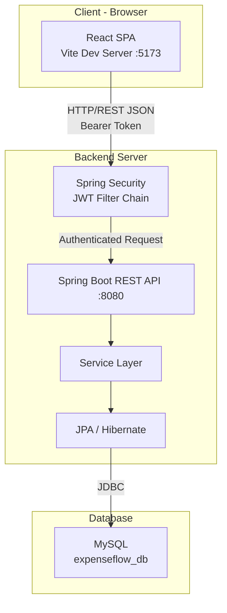

The system follows a **classic 3-tier architecture**:

| Tier | Technology | Responsibility |
|------|-----------|---------------|
| **Presentation** | React 18 + Vite 5 | SPA UI, routing, state management, API consumption |
| **Application** | Spring Boot 3.2.3 | REST API, business logic, authentication, validation |
| **Data** | MySQL + Hibernate JPA | Persistent storage, schema management, query execution |

**Communication:** The frontend communicates with the backend exclusively via RESTful JSON APIs. During development, Vite's proxy forwards `/api` requests to the Spring Boot server. In production, the backend URL is configured via the `VITE_API_BASE_URL` environment variable.

---

## 2. Project Directory Structure

```
ExpenseFlow/
├── backend/                              # Spring Boot Application
│   ├── pom.xml                           # Maven dependencies & build config
│   ├── mvnw / mvnw.cmd                   # Maven wrapper scripts
│   ├── Dockerfile                        # Container build instructions
│   └── src/main/
│       ├── java/com/expenseflow/
│       │   ├── ExpenseFlowApplication.java    # @SpringBootApplication entry point
│       │   ├── config/
│       │   │   └── SecurityConfig.java        # Spring Security + CORS config
│       │   ├── security/
│       │   │   ├── JwtTokenProvider.java      # JWT generation & validation
│       │   │   ├── JwtAuthenticationFilter.java # Per-request JWT filter
│       │   │   └── CustomUserDetailsService.java # UserDetails from DB
│       │   ├── entity/                        # JPA @Entity classes
│       │   │   ├── User.java
│       │   │   ├── Expense.java
│       │   │   ├── Income.java
│       │   │   ├── Category.java
│       │   │   └── Budget.java
│       │   ├── repository/                    # Spring Data JPA Repositories
│       │   │   ├── UserRepository.java
│       │   │   ├── ExpenseRepository.java
│       │   │   ├── IncomeRepository.java
│       │   │   ├── CategoryRepository.java
│       │   │   └── BudgetRepository.java
│       │   ├── service/                       # Business logic layer
│       │   │   ├── AuthService.java
│       │   │   ├── ExpenseService.java
│       │   │   ├── IncomeService.java
│       │   │   ├── CategoryService.java
│       │   │   ├── BudgetService.java
│       │   │   ├── DashboardService.java
│       │   │   └── UserService.java
│       │   ├── controller/                    # REST API endpoints
│       │   │   ├── AuthController.java
│       │   │   ├── ExpenseController.java
│       │   │   ├── IncomeController.java
│       │   │   ├── CategoryController.java
│       │   │   ├── BudgetController.java
│       │   │   ├── DashboardController.java
│       │   │   └── UserController.java
│       │   ├── dto/                           # Data Transfer Objects
│       │   │   ├── LoginRequest.java
│       │   │   ├── RegisterRequest.java
│       │   │   ├── AuthResponse.java
│       │   │   ├── ExpenseDTO.java
│       │   │   ├── IncomeDTO.java
│       │   │   ├── CategoryDTO.java
│       │   │   ├── BudgetDTO.java
│       │   │   ├── BudgetSummaryDTO.java
│       │   │   ├── DashboardSummaryDTO.java
│       │   │   ├── TransactionDTO.java
│       │   │   ├── UserProfileDTO.java
│       │   │   └── ErrorResponse.java
│       │   └── exception/                     # Custom exceptions + handler
│       │       ├── BadRequestException.java
│       │       ├── ResourceNotFoundException.java
│       │       ├── UnauthorizedException.java
│       │       └── GlobalExceptionHandler.java
│       └── resources/
│           └── application.properties         # App configuration
│
├── frontend/                              # React SPA
│   ├── package.json                       # NPM dependencies
│   ├── vite.config.js                     # Vite build + dev proxy config
│   ├── index.html                         # HTML entry point
│   ├── .env                               # Environment variables
│   └── src/
│       ├── main.jsx                       # React DOM render + providers
│       ├── App.jsx                        # Route definitions + layout
│       ├── index.css                      # Global styles (CSS3)
│       ├── context/
│       │   └── AuthContext.jsx            # Authentication state provider
│       ├── hooks/
│       │   └── useAuth.js                 # Auth context consumer hook
│       ├── services/                      # Axios API service modules
│       │   ├── api.js                     # Axios instance + interceptors
│       │   ├── authService.js
│       │   ├── expenseService.js
│       │   ├── incomeService.js
│       │   ├── categoryService.js
│       │   ├── budgetService.js
│       │   └── dashboardService.js
│       ├── pages/                         # Route-level page components
│       │   ├── Login.jsx
│       │   ├── Register.jsx
│       │   ├── Dashboard.jsx
│       │   ├── Expenses.jsx
│       │   ├── Income.jsx
│       │   ├── Transactions.jsx
│       │   ├── Budgets.jsx
│       │   ├── Categories.jsx
│       │   └── Profile.jsx
│       ├── components/                    # Reusable UI components
│       │   ├── Sidebar.jsx
│       │   ├── Navbar.jsx
│       │   ├── ProtectedRoute.jsx
│       │   ├── Modal.jsx
│       │   ├── LoadingSpinner.jsx
│       │   ├── ErrorMessage.jsx
│       │   ├── SummaryCard.jsx
│       │   ├── TransactionTable.jsx
│       │   ├── ExpenseForm.jsx
│       │   ├── ExpenseList.jsx
│       │   ├── IncomeForm.jsx
│       │   ├── IncomeList.jsx
│       │   ├── BudgetCard.jsx
│       │   └── CategoryList.jsx
│       └── utils/
│           └── formatters.js              # Currency & date formatting
│
├── run-app.bat                            # Launches backend + frontend together
├── run-backend.bat / run-backend.sh       # Backend-only launcher
├── run-frontend.bat                       # Frontend-only launcher
└── README.md
```

---

## 3. Backend Architecture (Spring Boot)

### 3.1 Layered Architecture

The backend strictly follows the **Controller → Service → Repository** pattern with DTOs for data transfer:

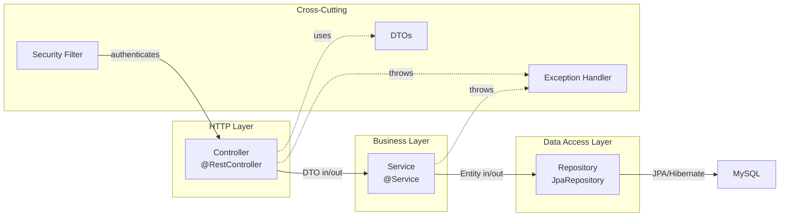

**Key Design Decisions:**
- **Stateless sessions** — No server-side sessions; all auth state lives in JWT tokens
- **DTO pattern** — Entities are never exposed directly to the API; DTOs decouple the API contract from the database schema
- **User-scoped queries** — Every repository method filters by the authenticated `User` to enforce data isolation
- **`@Transactional`** — All write operations are wrapped in transactions

---

### 3.2 Entity / Database Schema

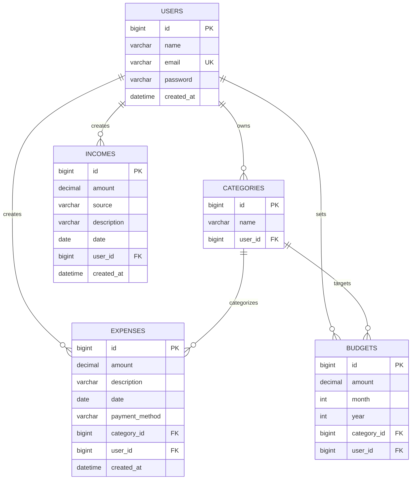

**Entity Details:**

| Entity | Table | Key Fields | Constraints |
|--------|-------|-----------|-------------|
| `User` | `users` | id, name, email, password, createdAt | email is `UNIQUE`; password is `@JsonIgnore` |
| `Expense` | `expenses` | id, amount, description, date, paymentMethod | amount `> 0.01`; `BigDecimal(12,2)` precision |
| `Income` | `incomes` | id, amount, source, description, date | source is `@NotBlank`; sources: Salary, Freelancing, Business, Investment, Bonus, Other |
| `Category` | `categories` | id, name | name `max 50 chars`; unique per user (enforced in service layer) |
| `Budget` | `budgets` | id, amount, month, year | `UNIQUE(user_id, category_id, month, year)`; month `1-12`, year `2000-2100` |

**Relationships:**
- Every entity has a `@ManyToOne` relationship to `User` (owner)
- `Expense` has a `@ManyToOne` to `Category` (optional, EAGER fetch)
- `Budget` has a `@ManyToOne` to `Category` (required, EAGER fetch)
- Hibernate manages schema creation via `ddl-auto=update`

---

### 3.3 Repository Layer (Data Access)

Each repository extends `JpaRepository<Entity, Long>` and provides user-scoped query methods:

| Repository | Key Methods | Custom Queries |
|-----------|-------------|---------------|
| `UserRepository` | `findByEmail()`, `existsByEmail()` | — |
| `ExpenseRepository` | `findByUserOrderByDateDesc...()`, `findByIdAndUser()` | `@Query sumTotalByUser()`, `sumByUserAndDateBetween()`, `sumByUserAndCategoryAndDateBetween()` |
| `IncomeRepository` | `findByUserOrderByDateDesc...()`, `findByIdAndUser()` | `@Query sumTotalByUser()`, `sumByUserAndDateBetween()` |
| `CategoryRepository` | `findByUser()`, `findByIdAndUser()`, `existsByNameAndUser()` | — |
| `BudgetRepository` | `findByUser()`, `findByUserAndMonthAndYear()`, `existsByUserAndCategoryAndMonthAndYear()` | — |

> **Data Isolation Pattern:** Every query method includes a `User` parameter. There is no way to retrieve data across users at the repository level.

---

### 3.4 Service Layer (Business Logic)

Each service retrieves the current authenticated user from `SecurityContextHolder` and passes it to repository calls:

```java
private User getCurrentUser() {
    String email = SecurityContextHolder.getContext().getAuthentication().getName();
    return userRepository.findByEmail(email)
            .orElseThrow(() -> new ResourceNotFoundException("Authenticated user not found"));
}
```

**Service Breakdown:**

| Service | Responsibility |
|---------|---------------|
| **AuthService** | Registration (BCrypt hashing + default category seeding), login (via `AuthenticationManager`), fetching current authenticated user from `SecurityContext` |
| **ExpenseService** | CRUD for expenses; validates category ownership; converts Entity ↔ DTO |
| **IncomeService** | CRUD for income records; converts Entity ↔ DTO |
| **CategoryService** | CRUD for categories; seeds 9 default categories on user registration: `Food, Shopping, Transportation, Bills, Entertainment, Healthcare, Education, Travel, Other`; enforces unique names per user |
| **BudgetService** | CRUD for monthly budgets; computes spent/remaining/percentage by querying `ExpenseRepository` for the budget's category+month+year range; prevents duplicate budgets |
| **DashboardService** | Aggregates: total income/expenses, current balance, current month spending vs budget, last 6 months income-vs-expense comparison, expense-by-category breakdown, top 10 recent transactions |
| **UserService** | Returns user profile DTO with counts of expenses, incomes, and budgets |

---

### 3.5 Controller Layer (REST API)

All controllers are annotated with `@RestController` and expose endpoints under `/api/*`.

| Controller | Base Path | Endpoints |
|-----------|----------|-----------|
| `AuthController` | `/api/auth` | `POST /register`, `POST /login`, `GET /me` |
| `ExpenseController` | `/api/expenses` | `GET /`, `GET /{id}`, `POST /`, `PUT /{id}`, `DELETE /{id}` |
| `IncomeController` | `/api/income` | `GET /`, `GET /{id}`, `POST /`, `PUT /{id}`, `DELETE /{id}` |
| `CategoryController` | `/api/categories` | `GET /`, `POST /`, `PUT /{id}`, `DELETE /{id}` |
| `BudgetController` | `/api/budgets` | `GET /?month=&year=`, `GET /{id}`, `POST /`, `PUT /{id}`, `DELETE /{id}` |
| `DashboardController` | `/api/dashboard` | `GET /summary` |
| `UserController` | `/api/users` | `GET /profile` |

**Authorization Rules:**
- `/api/auth/**` → **Public** (no JWT required)
- All other endpoints → **Authenticated** (valid JWT required)

---

### 3.6 DTO Layer (Data Transfer Objects)

DTOs decouple the API contract from internal entities:

| DTO | Direction | Purpose |
|-----|----------|---------|
| `LoginRequest` | Request | email, password |
| `RegisterRequest` | Request | name, email, password (validated) |
| `AuthResponse` | Response | token, id, name, email |
| `ExpenseDTO` | Both | amount, description, date, paymentMethod, categoryId, categoryName |
| `IncomeDTO` | Both | amount, source, description, date |
| `CategoryDTO` | Both | id, name |
| `BudgetDTO` | Request | amount, month, year, categoryId |
| `BudgetSummaryDTO` | Response | id, amount, spent, remaining, percentage, month, year, categoryId, categoryName |
| `DashboardSummaryDTO` | Response | totalIncome, totalExpenses, currentBalance, currentMonthSpending, budgetTotals, recentTransactions, categoryExpenses map, monthlyComparison list |
| `TransactionDTO` | Response | id, type (INCOME/EXPENSE), amount, description, category, paymentMethod, date |
| `UserProfileDTO` | Response | id, name, email, createdAt, expenseCount, incomeCount, budgetCount |
| `ErrorResponse` | Response | status, message, optional validation errors map |

---

### 3.7 Security Pipeline (JWT + Spring Security)

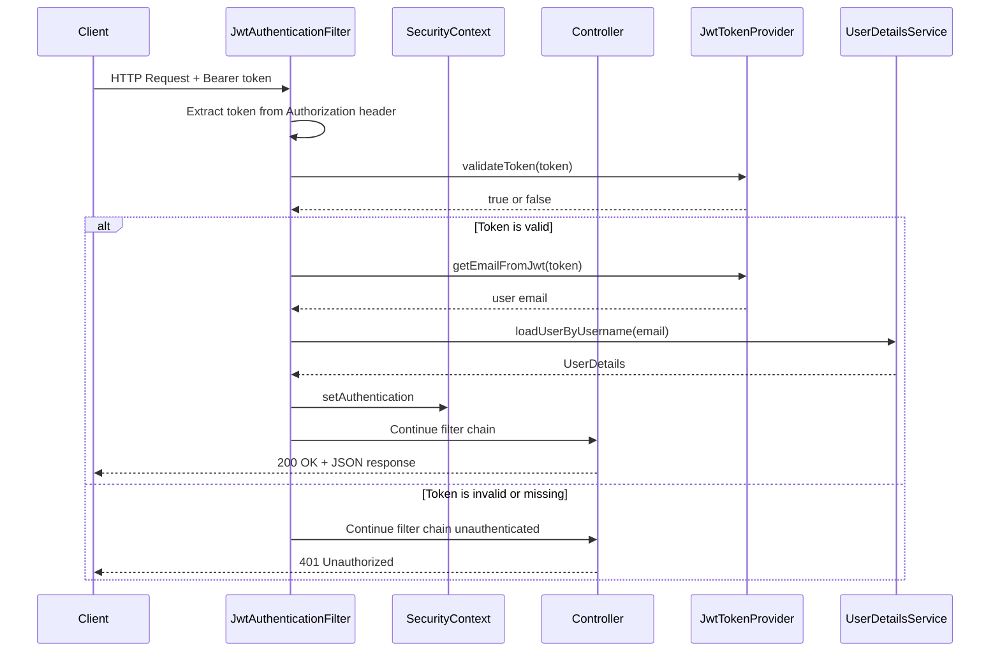

**Security Configuration (`SecurityConfig.java`):**
1. **CSRF** disabled (stateless API)
2. **Session Management** → `STATELESS` (no HttpSession)
3. **CORS** → Configured from `app.cors.allowed-origins` property
4. **Password Encoding** → `BCryptPasswordEncoder`
5. **Filter Order** → `JwtAuthenticationFilter` runs before `UsernamePasswordAuthenticationFilter`
6. **Public endpoints** → `/api/auth/**` and `/error`

**JWT Token Details:**
- **Algorithm:** HMAC-SHA512
- **Subject:** User's email address
- **Expiration:** 24 hours (86400000 ms, configurable)
- **Secret:** 64+ byte key from `app.jwt.secret`

---

### 3.8 Exception Handling

A centralized `@RestControllerAdvice` (`GlobalExceptionHandler`) maps exceptions to HTTP responses:

| Exception | HTTP Status | When Thrown |
|-----------|-------------|------------|
| `ResourceNotFoundException` | `404 Not Found` | Entity not found by ID + User |
| `BadRequestException` | `400 Bad Request` | Duplicate email, duplicate category, duplicate budget |
| `UnauthorizedException` | `401 Unauthorized` | Invalid credentials, unauthenticated access |
| `BadCredentialsException` | `401 Unauthorized` | Spring Security login failure |
| `MethodArgumentNotValidException` | `400 Bad Request` | `@Valid` annotation validation failures (field-level errors) |
| `Exception` (catch-all) | `500 Internal Server Error` | Unexpected errors |

All errors return a structured `ErrorResponse` JSON:
```json
{
  "status": 400,
  "message": "Validation failed for one or more fields",
  "errors": {
    "email": "must be a valid email",
    "amount": "Amount must be greater than 0"
  }
}
```

---

### 3.9 Configuration

**`application.properties`** key settings:

| Property | Purpose | Default |
|----------|---------|---------|
| `server.port` | HTTP port | `8080` |
| `spring.datasource.url` | MySQL JDBC URL | `localhost:3306/expenseflow_db` |
| `spring.jpa.hibernate.ddl-auto` | Schema strategy | `update` (auto-migrate) |
| `app.jwt.secret` | JWT signing key | 64-byte secret |
| `app.jwt.expiration-ms` | Token lifetime | `86400000` (24h) |
| `app.cors.allowed-origins` | Allowed CORS origins | `localhost:5173, localhost:3000` |

---

## 4. Frontend Architecture (React + Vite)

### 4.1 Component Hierarchy

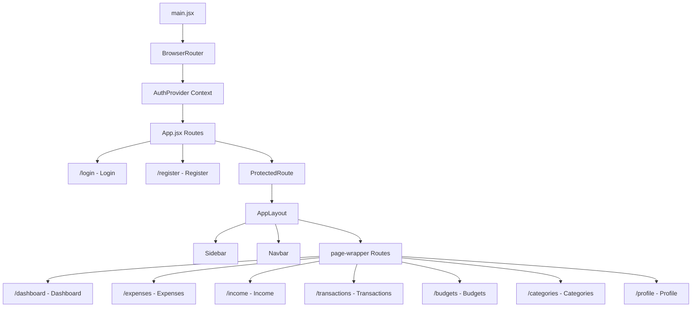

---

### 4.2 State Management & Auth Flow

**State Management Strategy:** React Context API + `localStorage` (no Redux).

**`AuthContext`** provides:

| Value | Type | Description |
|-------|------|-------------|
| `user` | Object `{id, name, email}` | Current user info |
| `token` | String | JWT token |
| `loading` | Boolean | Auth verification in progress |
| `login(credentials)` | Function | Calls API, stores token + user |
| `register(userData)` | Function | Calls API, stores token + user |
| `logout()` | Function | Clears token + user from state and localStorage |

**Auth Persistence:** Token and user data are stored in `localStorage`. On app mount, `AuthContext` verifies the token by calling `GET /api/auth/me`. If the server returns `401`, the user is logged out.

---

### 4.3 Service Layer (API Communication)

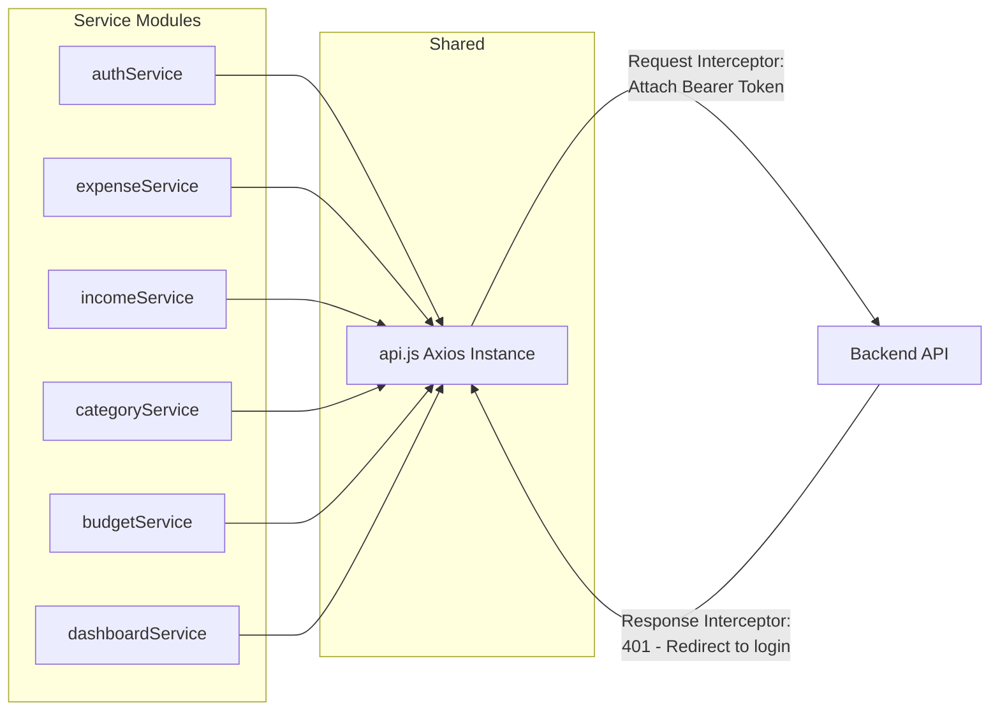

**`api.js` — Centralized Axios Configuration:**
- **Base URL:** Reads from `VITE_API_URL` env var or defaults to Render backend URL
- **Timeout:** 45 seconds (accommodates Render cold starts)
- **Request Interceptor:** Automatically attaches `Authorization: Bearer <token>` from `localStorage`
- **Response Interceptor:** On `401` response, clears auth data and redirects to `/login` (except on login/register pages)

---

### 4.4 Routing & Protected Routes

| Route | Component | Auth Required | Description |
|-------|-----------|:---:|-------------|
| `/login` | `Login` | No | Email/password sign-in |
| `/register` | `Register` | No | New account creation |
| `/dashboard` | `Dashboard` | Yes | Financial overview with charts |
| `/expenses` | `Expenses` | Yes | Expense CRUD + modal form |
| `/income` | `Income` | Yes | Income CRUD + modal form |
| `/transactions` | `Transactions` | Yes | Unified ledger with filters |
| `/budgets` | `Budgets` | Yes | Monthly budget management |
| `/categories` | `Categories` | Yes | Category management |
| `/profile` | `Profile` | Yes | User profile and stats |
| `/*` (fallback) | Redirect | — | Redirects to `/dashboard` (authenticated) or `/login` (unauthenticated) |

**`ProtectedRoute` Component:** Wraps all authenticated routes. Uses `useAuth()` hook to check if `user` exists. Shows `LoadingSpinner` while auth verification is in progress. Redirects to `/login` if unauthenticated.

---

### 4.5 Pages Overview

| Page | Key Functionality |
|------|------------------|
| **Login** | Email + password form; error handling for timeouts, network errors, invalid credentials; navigates to `/dashboard` on success |
| **Register** | Name + email + password + confirm password form; auto-login after registration |
| **Dashboard** | Fetches `DashboardSummaryDTO`; renders 4 summary cards (Total Income, Total Expenses, Balance, Monthly Budget); Income vs Expense bar chart (Recharts); Expense by Category donut pie chart; Recent transactions table (top 10) |
| **Expenses** | Lists all expenses; Add/Edit via modal with `ExpenseForm`; Delete with confirmation; Parallel fetches expenses + categories |
| **Income** | Lists all income records; Add/Edit via modal with `IncomeForm`; Delete with confirmation |
| **Transactions** | Unified view combining expenses + incomes; Sortable by date/amount/type; Filterable by type (Income/Expense), search text, date range |
| **Budgets** | Month/Year selector; Lists budgets as `BudgetCard` components with progress bars; Shows spent/remaining/percentage; Visual indicators (green/yellow/red) for budget status |
| **Categories** | Lists categories; Inline add/rename; Delete with confirmation |
| **Profile** | Displays user name, email, account creation date; Shows counts of expenses, incomes, budgets |

---

### 4.6 Reusable Components

| Component | Purpose |
|-----------|---------|
| `Sidebar` | Fixed sidebar navigation with NavLink active states; Lucide icons; User info footer with logout |
| `Navbar` | Top header bar; Welcome message; User badge; Logout button; Mobile hamburger toggle |
| `ProtectedRoute` | Auth gate using `Outlet` pattern |
| `Modal` | Generic overlay modal for forms |
| `LoadingSpinner` | Centered spinner with configurable text |
| `ErrorMessage` | Error display with optional retry button |
| `SummaryCard` | Dashboard metric card (title, amount, subtext, icon, color) |
| `TransactionTable` | Renders transaction rows with type badge (INCOME/EXPENSE), formatted amount, date, category |
| `ExpenseForm` | Controlled form: amount, description, date, category dropdown, payment method selector |
| `ExpenseList` | Renders expense cards with edit/delete actions |
| `IncomeForm` | Controlled form: amount, source dropdown, description, date |
| `IncomeList` | Renders income cards with edit/delete actions |
| `BudgetCard` | Budget display with progress bar, spent/remaining amounts, percentage badge |
| `CategoryList` | Category chips with rename/delete actions |

---

## 5. Core Workflow Diagrams

### 5.1 User Registration Flow

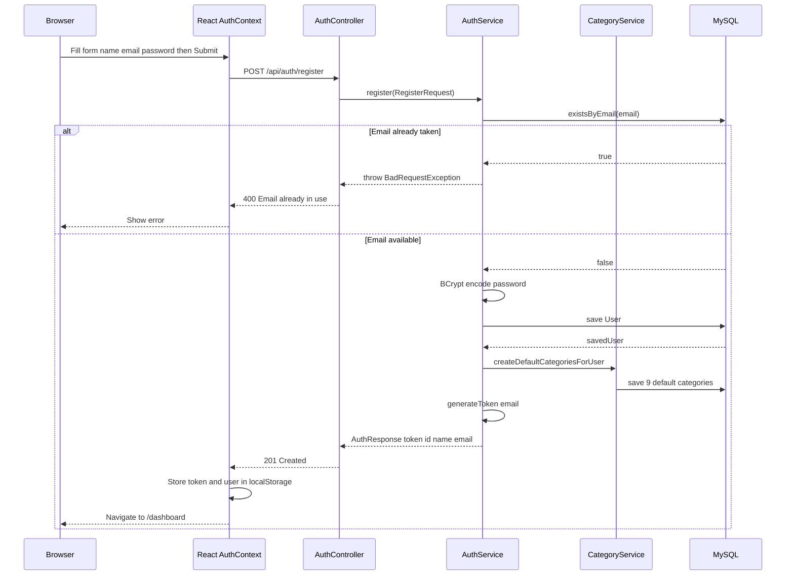

---

### 5.2 Authentication (Login) Flow

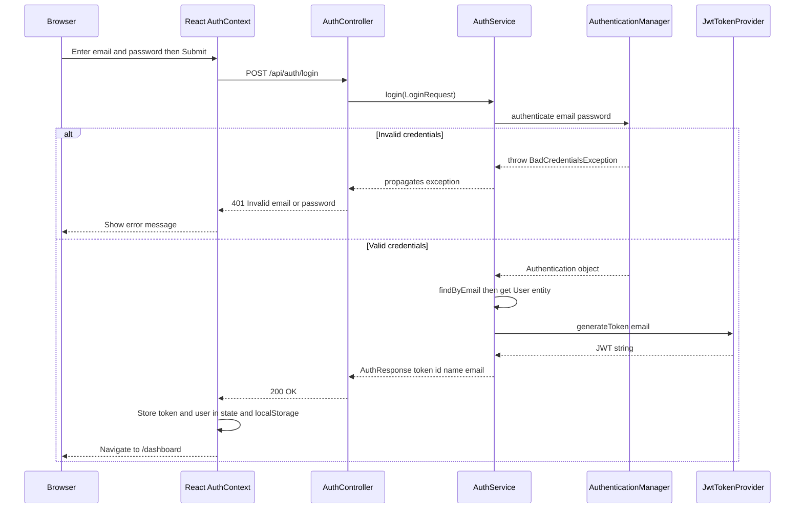

---

### 5.3 Authenticated API Request Flow

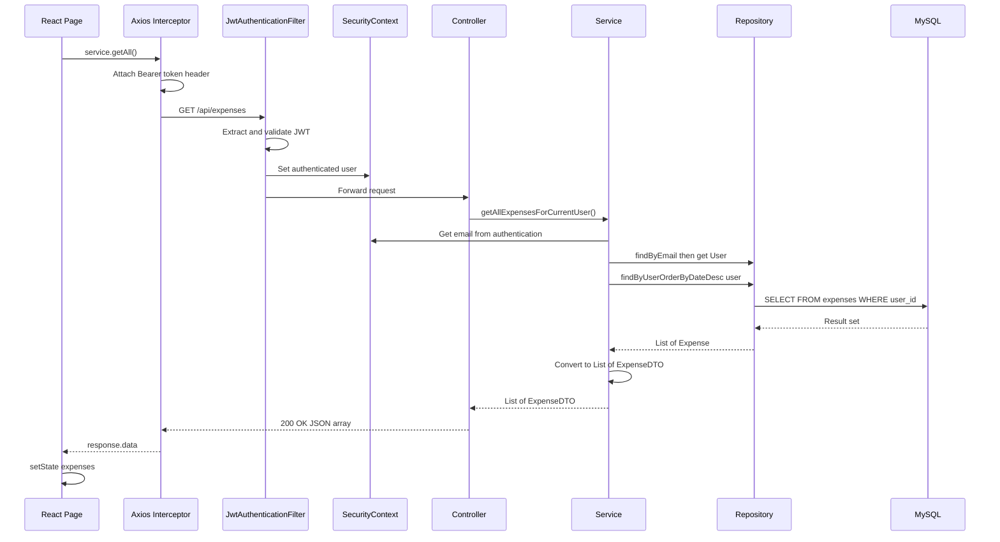

---

### 5.4 Expense CRUD Workflow

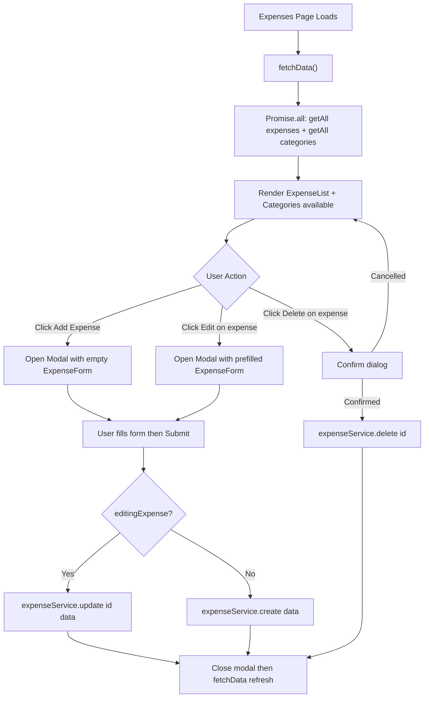

---

### 5.5 Dashboard Data Aggregation Flow

The `DashboardService` performs multiple database queries to build a comprehensive financial summary in a single API call:

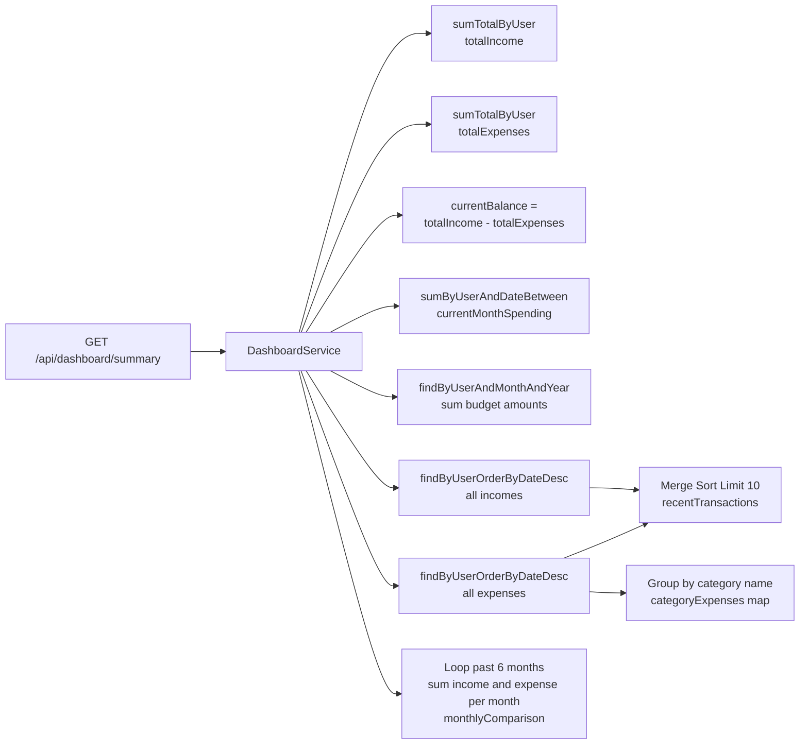

**What the Dashboard displays:**
1. **Summary Cards** — Total Income, Total Expenses, Current Balance, Current Month Budget (with spent/remaining)
2. **Bar Chart** — Income vs Expense comparison for the last 6 months (Recharts `BarChart`)
3. **Pie Chart** — Expense distribution by category (Recharts `PieChart` with donut hole)
4. **Recent Transactions** — Top 10 combined income + expense records sorted by date

---

### 5.6 Budget Tracking Workflow

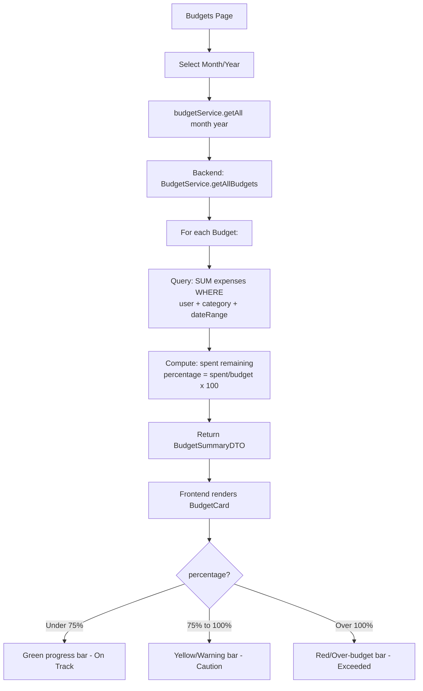

---

## 6. API Reference

### Authentication (Public)

| Method | Endpoint | Request Body | Response |
|--------|---------|-------------|---------|
| `POST` | `/api/auth/register` | `{name, email, password}` | `201 {token, id, name, email}` |
| `POST` | `/api/auth/login` | `{email, password}` | `200 {token, id, name, email}` |
| `GET` | `/api/auth/me` | — | `200 {id, name, email, createdAt}` |

### Expenses (Authenticated)

| Method | Endpoint | Request Body | Response |
|--------|---------|-------------|---------|
| `GET` | `/api/expenses` | — | `200 [ExpenseDTO]` |
| `GET` | `/api/expenses/{id}` | — | `200 ExpenseDTO` |
| `POST` | `/api/expenses` | `{amount, description, date, paymentMethod, categoryId}` | `201 ExpenseDTO` |
| `PUT` | `/api/expenses/{id}` | `{amount, description, date, paymentMethod, categoryId}` | `200 ExpenseDTO` |
| `DELETE` | `/api/expenses/{id}` | — | `204 No Content` |

### Income (Authenticated)

| Method | Endpoint | Request Body | Response |
|--------|---------|-------------|---------|
| `GET` | `/api/income` | — | `200 [IncomeDTO]` |
| `GET` | `/api/income/{id}` | — | `200 IncomeDTO` |
| `POST` | `/api/income` | `{amount, source, description, date}` | `201 IncomeDTO` |
| `PUT` | `/api/income/{id}` | `{amount, source, description, date}` | `200 IncomeDTO` |
| `DELETE` | `/api/income/{id}` | — | `204 No Content` |

### Categories (Authenticated)

| Method | Endpoint | Request Body | Response |
|--------|---------|-------------|---------|
| `GET` | `/api/categories` | — | `200 [CategoryDTO]` |
| `POST` | `/api/categories` | `{name}` | `201 CategoryDTO` |
| `PUT` | `/api/categories/{id}` | `{name}` | `200 CategoryDTO` |
| `DELETE` | `/api/categories/{id}` | — | `204 No Content` |

### Budgets (Authenticated)

| Method | Endpoint | Query Params | Request Body | Response |
|--------|---------|-------------|-------------|---------|
| `GET` | `/api/budgets` | `?month=&year=` (optional) | — | `200 [BudgetSummaryDTO]` |
| `GET` | `/api/budgets/{id}` | — | — | `200 BudgetSummaryDTO` |
| `POST` | `/api/budgets` | — | `{amount, month, year, categoryId}` | `201 BudgetSummaryDTO` |
| `PUT` | `/api/budgets/{id}` | — | `{amount, month, year, categoryId}` | `200 BudgetSummaryDTO` |
| `DELETE` | `/api/budgets/{id}` | — | — | `204 No Content` |

### Dashboard (Authenticated)

| Method | Endpoint | Response |
|--------|---------|---------|
| `GET` | `/api/dashboard/summary` | `200 DashboardSummaryDTO` |

### User Profile (Authenticated)

| Method | Endpoint | Response |
|--------|---------|---------|
| `GET` | `/api/users/profile` | `200 UserProfileDTO` |

---

## 7. Data Isolation & Multi-Tenancy

ExpenseFlow implements **row-level data isolation** through a consistent pattern:

1. **Every entity** has a `user_id` foreign key
2. **Every repository query** includes the authenticated `User` as a parameter
3. **Every service method** retrieves `getCurrentUser()` from `SecurityContextHolder` before querying
4. **No cross-user data access** is possible — there are no admin endpoints or superuser bypasses

```java
// Pattern used in every service:
User user = getCurrentUser();  // From JWT -> SecurityContext -> DB lookup
Expense expense = expenseRepository.findByIdAndUser(id, user)  // Scoped query
    .orElseThrow(() -> new ResourceNotFoundException("Not found"));
```

This means that even if a user guesses another user's expense ID, the `findByIdAndUser()` query will return empty, and a `404` is returned — not the other user's data.

---

## 8. Deployment Architecture

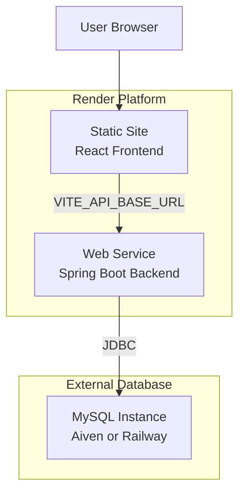

**Deployment Configuration:**

| Component | Render Type | Build Command | Start/Publish |
|-----------|-----------|--------------|--------------|
| Frontend | Static Site | `npm install && npm run build` | Publish: `dist/` |
| Backend | Web Service | `./mvnw clean package -DskipTests` | `java -jar target/expenseflow-backend-0.0.1-SNAPSHOT.jar` |

**Environment Variables for Deployment:**
- Backend: `SPRING_DATASOURCE_URL`, `SPRING_DATASOURCE_PASSWORD`, `JWT_SECRET`, `CORS_ALLOWED_ORIGINS`
- Frontend: `VITE_API_BASE_URL` → points to backend URL + `/api`

**Development Setup:**
- Backend runs on `:8080`
- Frontend runs on `:5173` with Vite proxy forwarding `/api` to `:8080`
- Convenience scripts: `run-app.bat` (both), `run-backend.bat`, `run-frontend.bat`
